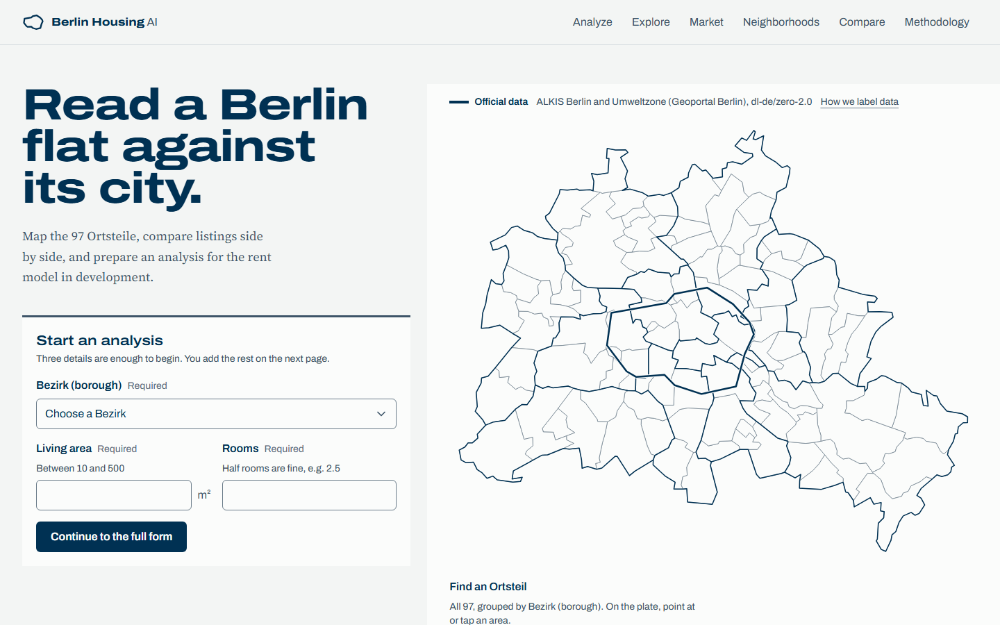
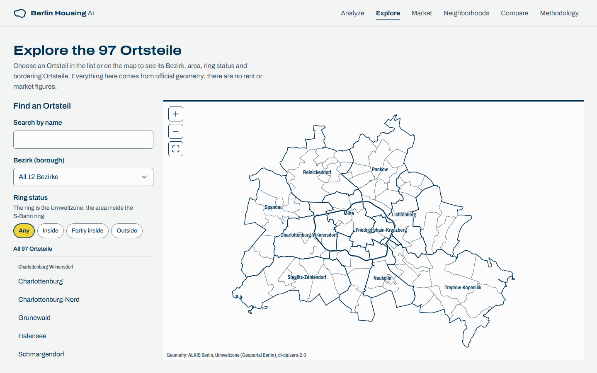
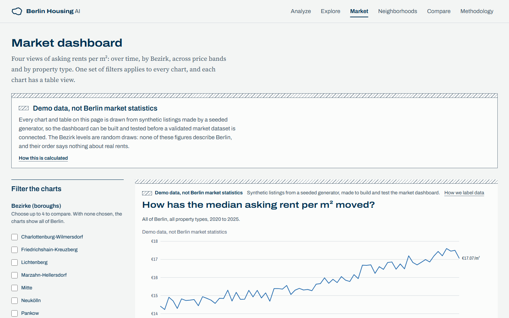
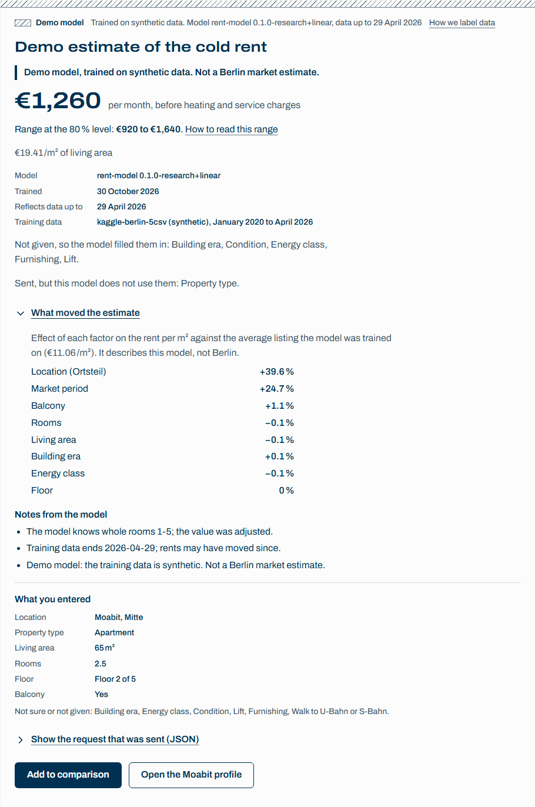

# Berlin Housing AI

A Berlin housing tool built around one rule, **nothing is shown as fact unless its source says it is**. You can explore the 12 Bezirke and 97 Ortsteile on official geometry, compare listings you have found, and prepare a flat for a rent-prediction model. The model that exists is a **demo trained on synthetic data**, and the site says so wherever it answers.

**Live: [berlinhouse.netlify.app](https://berlinhouse.netlify.app/)** (the Analyze page answers with the demo model, trained on synthetic data)



## What is real and what is a demo

| Part | Status | Backing |
|---|---|---|
| Bezirk and Ortsteil boundaries, areas, neighbors, ring status | **Real** | ALKIS Berlin and Umweltzone, Geoportal Berlin, dl-de/zero-2.0, checksummed |
| Market dashboard (`/market`) | **Demo data** | Generated by a seeded script. Not Berlin statistics. |
| Rent model (`/analyze`) | **Demo model** | Trained on a synthetic dataset (below). Off by default. |
| Listings you compare, flats you describe | Your entries | Kept in your browser only |
| Neighborhood descriptions, transit access | Not written / not connected | The site says so instead of filling the space |

Every data-bearing module carries a legend band that names its provenance. A demo answer is drawn with a hatched band and the words *"Demo model, trained on synthetic data. Not a Berlin market estimate."* The figure never appears in a page title, a preview, the home page or beside a real figure.

| Explore the Ortsteile | Demo market charts |
|---|---|
|  |  |

## The model, and why it is labelled a demo

The model was trained on the Kaggle dataset [`sergionefedov/berlin-real-estate-sales-and-rentals-2020-2026`](https://www.kaggle.com/datasets/sergionefedov/berlin-real-estate-sales-and-rentals-2020-2026) (Sergey Nefedov, Apache 2.0). Its author writes that the Ortsteil coordinates, the stations and the interest-rate timeline are real, and that the listing-level apartment characteristics are *generated from the hedonic model*. The intake checks here agree (no missing values, almost no round-number rents, a market level that moves in half-year steps), so the dataset is **demo-only**: see [`data/PROVENANCE.md`](data/PROVENANCE.md).

What this means for the model:

- It learned to reproduce a pricing model, not Berlin. Its error (about 144 € per month on 2025) measures how well it recovers that generator.
- Three families tie on a time-ordered split: linear regression 144 €, CatBoost 145 €, a small neural network 144 €. The tie is expected on data generated by a log-linear model, so the simple linear model is the one served.
- The 80 % interval (split conformal) covered 78.9 % of 2025 and 76.4 % of 2026 on months it was not built from.
- The label is lifted only if a model trained on observed data replaces it, which is a separate decision ([D-058](docs/implementation/DECISIONS.md)).

### Use the model

The model files and a plain-language model card are public on Hugging Face: **[mfozdil/berlin-rent-demo](https://huggingface.co/mfozdil/berlin-rent-demo)**. With `pip install huggingface_hub numpy pandas`:

```python
import sys
from huggingface_hub import snapshot_download

path = snapshot_download("mfozdil/berlin-rent-demo")
sys.path.insert(0, path)
from inference import RentModel

status, result = RentModel(path).predict(
    {"bezirk": "Mitte", "property_type": "apartment", "rooms": 2, "area_m2": 65}
)
print(result["estimate"]["monthly_cold_rent"], result["model"]["training_data"]["synthetic"])
```

Every answer carries `synthetic: True`. The card lists the inputs, the range and the limits.



The full account is on the site's `/methodology` page and in the [model card](services/rent-api/MODEL_CARD.md).

## How it fits together

```
Browser ── Next.js 16 (App Router, TypeScript strict)
              │  /api/predictions/rent  (server-side)
              ▼
           demo model, in the same server (TypeScript)   ── reads the JSON in services/rent-api/artifacts
           FastAPI service  services/rent-api            ── the same model in Python, optional (proxy mode)
```

- **Frontend:** Next.js, React, Zod contracts, MapLibre kept out of every first-load chunk, an "Atlas" design system with contrast-checked tokens ([`docs/design`](docs/design/DESIGN_SYSTEM.md)).
- **Contract:** [`PREDICTION_API.md`](docs/contracts/PREDICTION_API.md). A response that does not say `synthetic: true` is never shown as an estimate.
- **Model:** `src/lib/model/rent-model.ts` runs the demo model inside the site's server (`NEXT_PUBLIC_PREDICTION_MODE=embedded`, what the live site uses). It is a port of the Python service and is tested against answers the service gave.
- **Service:** `services/rent-api`: model card, health, schema and prediction endpoints, one error envelope. No pickle and no scikit-learn at run time.
- **Tests:** 344 unit, component and contract tests (Vitest), Playwright journeys at 375, 768 and 1440 px, axe on every route, and an end-to-end suite against the real service.

## Run it

Requirements: Node.js ≥ 20.9 (developed on 22.16), npm ≥ 10. No API keys are needed.

```bash
npm install
npm run dev           # http://localhost:3000, prediction disabled
npm run check         # typecheck + lint + unit tests + production build
npm run test:e2e      # Playwright (first run: npx playwright install chromium)
```

To see the demo model answer locally, the simplest way is to build with it inside the server:

```bash
NEXT_PUBLIC_PREDICTION_MODE=embedded npm run build && npm start     # PowerShell: $env:NEXT_PUBLIC_PREDICTION_MODE="embedded"
```

Or run the Python service and point the proxy at it (Python 3.12):

```bash
cd services/rent-api
python -m venv .venv
.venv/Scripts/python -m pip install -r requirements-dev.txt     # Windows; use .venv/bin/python elsewhere
.venv/Scripts/python -m uvicorn rent_api.main:app --port 8000
```

Then set `NEXT_PUBLIC_PREDICTION_MODE=proxy` and `PREDICTION_API_BASE_URL=http://127.0.0.1:8000` in `.env.local` (see [`.env.example`](.env.example)) and restart. Prediction is **disabled** by default. Never put a backend secret in a `NEXT_PUBLIC_` variable.

## Documentation (source of truth)

| Doc | What it decides |
|---|---|
| [docs/product/VISION.md](docs/product/VISION.md) | Direction and phases |
| [docs/product/PRD.md](docs/product/PRD.md) | Scope, capability truth table, acceptance criteria |
| [docs/architecture/DATA_BOUNDARIES.md](docs/architecture/DATA_BOUNDARIES.md) | Provenance kinds, demo vs real rules, dataset intake protocol |
| [docs/architecture/FRONTEND_ARCHITECTURE.md](docs/architecture/FRONTEND_ARCHITECTURE.md) | Stack, layout, routes, state, geo pipeline, testing |
| [docs/contracts/PREDICTION_API.md](docs/contracts/PREDICTION_API.md) | The `POST /api/v1/predictions/rent` contract |
| [docs/design/DESIGN_SYSTEM.md](docs/design/DESIGN_SYSTEM.md) | Tokens, type, grid, provenance notation, chart palette |
| [docs/implementation/TASKS.md](docs/implementation/TASKS.md) | Vertical slices, checks and known gaps |
| [docs/implementation/DECISIONS.md](docs/implementation/DECISIONS.md) | Decision log |
| [data/PROVENANCE.md](data/PROVENANCE.md) | Dataset registry: sources, licenses, checksums |

## Known gaps

- No screen-reader pass yet (no NVDA, Firefox or VoiceOver on the development machine).
- First-load JS is over the original 150 kB budget on form and chart routes, under the restated one ([D-057](docs/implementation/DECISIONS.md)).
- No real market data and no real listing data: nothing free and redistributable is available at listing level. Candidates for official aggregates (Zensus 2022, Mietspiegel 2024) have not passed intake yet.
- The live site's rent model is the demo trained on synthetic data. It answers on Analyze only, under the demo band, and says nothing about real Berlin rents.
- The MIT licence covers this repository's own files. The geodata and the Kaggle dataset keep their licences, listed below.

## Licenses

- The code, the documentation and the model files in this repository: [MIT](LICENSE).
- Boundaries: ALKIS Berlin (Geoportal Berlin), Datenlizenz Deutschland – Zero – Version 2.0. Umweltzone: Geoportal Berlin, dl-de/zero-2.0.
- Kaggle dataset used to train the demo model: Apache 2.0, Sergey Nefedov. The files are not in this repository.
